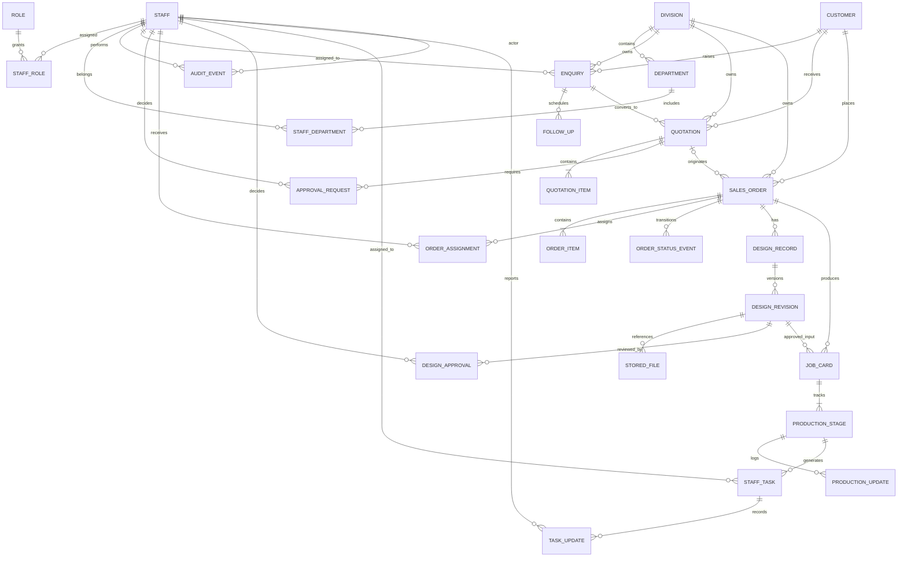

# SADACO ERP — Phase 1 Data Model & ERD

**Status:** Proposed logical data model. No SQL migration is included or applied.  
**Baseline:** SADACO ERP Final Requirements & Functional Specification, sections 1–9, 21–24.  
**Scope:** Phase 1 only. Later-phase structures appear only where a Phase 1 relation needs a stable interface.

## 1. Modeling decisions

- PostgreSQL is the persistence target. Use UUID primary keys for internal identity; human-readable order/quotation numbers are separate unique business identifiers.
- All monetary values use `NUMERIC(14,2)` in INR. Quantities and dimensions use appropriate `NUMERIC` precision and explicit units. Never use floating-point for money.
- Transactional records carry `created_at`, `updated_at`, `created_by_id`, and where applicable `updated_by_id`; important state changes have append-only history.
- Division-owned records carry `division_id`; access checks are enforced at the API/service layer and tested.
- Customer master is shared across divisions; customer relationships/transactions record the division that owns them.
- File bytes are stored outside PostgreSQL behind private storage; database rows store object key, original name, MIME type, byte size, checksum, uploader and timestamps.
- Avoid hard-coded unspecified thresholds, rates, tax, supplier data, limits or stock reorder levels.
- This is a logical proposal. Confirm the exact authentication provider contract before linking external identity IDs.

## 2. Entity relationship map

## 3. Reference and access-control entities

### `divisions`
- `id UUID PK`
- `code VARCHAR(30) UNIQUE NOT NULL` — configured codes for SADACO Creatives, SADACO CNC, SADACO Decor Co.
- `name VARCHAR(120) UNIQUE NOT NULL`
- `is_active BOOLEAN NOT NULL DEFAULT TRUE`
- timestamps and actor references

Seed exactly the three divisions named in the PDF. Division code values are implementation identifiers, not user-facing business rules.

### `departments`
- `id UUID PK`, `division_id UUID FK divisions NOT NULL`
- `name VARCHAR(120) NOT NULL`, `description TEXT NULL`, `is_active BOOLEAN`
- timestamps and actor references
- unique `(division_id, name)`

Do not invent a definitive department list beyond the functional production areas in the approved requirements. Founder can configure departments.

### `staff`
- `id UUID PK`
- `full_name VARCHAR(180) NOT NULL`
- `mobile VARCHAR(30) NULL`, `email VARCHAR(254) NULL`
- `employment_status VARCHAR(20) NOT NULL` with controlled values such as active/inactive
- `auth_subject VARCHAR(255) UNIQUE NULL` — external identity subject only after auth integration is confirmed
- `is_active BOOLEAN NOT NULL DEFAULT TRUE`
- timestamps and actor references

The PDF identifies Founder/Super Admin, Manager Abdul Basith, Designer Muhaimin Kadungapuram, Designer Ashiq Wandoor, Production Support Junaid Edayur, CNC In-charge Shibili and Polishing Sakeer NTR. Treat those as required staff/role mappings to be confirmed before production seeding; do not create passwords or pretend accounts are verified.

### `roles`
- `id UUID PK`, `code VARCHAR(60) UNIQUE NOT NULL`, `name VARCHAR(100) NOT NULL`, `description TEXT NULL`
- `is_system BOOLEAN NOT NULL DEFAULT FALSE`

### `permissions`
- `id UUID PK`, `code VARCHAR(100) UNIQUE NOT NULL`, `description TEXT NOT NULL`

### `role_permissions`
- `role_id UUID FK roles`, `permission_id UUID FK permissions`
- composite PK `(role_id, permission_id)`

### `staff_roles`
- `id UUID PK`, `staff_id UUID FK staff`, `role_id UUID FK roles`
- `division_id UUID FK divisions NULL`, `department_id UUID FK departments NULL`
- `valid_from TIMESTAMPTZ NOT NULL`, `valid_until TIMESTAMPTZ NULL`
- `granted_by_id UUID FK staff`
- add a constraint preventing duplicate active assignments for the same staff/role/scope

### `staff_departments`
- `staff_id UUID FK staff`, `department_id UUID FK departments`, `is_primary BOOLEAN`
- composite unique `(staff_id, department_id)`

### `audit_events`
- `id UUID PK`, `actor_staff_id UUID FK staff NULL`
- `entity_type VARCHAR(100) NOT NULL`, `entity_id UUID NOT NULL`
- `action VARCHAR(40) NOT NULL`, `occurred_at TIMESTAMPTZ NOT NULL`
- `before_data JSONB NULL`, `after_data JSONB NULL`, `reason TEXT NULL`, `request_id VARCHAR(100) NULL`
- append-only; no ordinary update/delete endpoint

### `approval_requests`
- `id UUID PK`, `division_id UUID FK divisions NOT NULL`
- `entity_type VARCHAR(80) NOT NULL`, `entity_id UUID NOT NULL`
- `approval_type VARCHAR(60) NOT NULL`, `status VARCHAR(24) NOT NULL`
- `requested_by_id UUID FK staff NOT NULL`, `decided_by_id UUID FK staff NULL`
- `requested_at TIMESTAMPTZ NOT NULL`, `decided_at TIMESTAMPTZ NULL`
- `reason TEXT NULL`, `decision_note TEXT NULL`, `requested_value NUMERIC(14,2) NULL`
- approval limits are configured separately; do not set invented default limits

## 4. CRM entities

### `customers`
- `id UUID PK`, `customer_code VARCHAR(40) UNIQUE NOT NULL`
- `display_name VARCHAR(180) NOT NULL`, `mobile VARCHAR(30) NULL`, `whatsapp_mobile VARCHAR(30) NULL`
- `email VARCHAR(254) NULL`, `address TEXT NULL`, `location VARCHAR(180) NULL`
- `customer_type VARCHAR(40) NULL`, `notes TEXT NULL`, `is_active BOOLEAN NOT NULL`
- timestamps and actor references
- Index normalized mobile; do not impose unique mobile because shared/family/business contacts can be legitimate. Duplicate warnings require human confirmation.

### `enquiries`
- `id UUID PK`, `enquiry_number VARCHAR(40) UNIQUE NOT NULL`
- `customer_id UUID FK customers NOT NULL`, `division_id UUID FK divisions NOT NULL`
- `enquiry_date DATE NOT NULL`, `source VARCHAR(30) NOT NULL`
- `requested_product_service TEXT NOT NULL`, `customer_type_snapshot VARCHAR(40) NULL`
- `assigned_to_id UUID FK staff NULL`, `follow_up_at TIMESTAMPTZ NULL`
- `status VARCHAR(30) NOT NULL`, `notes TEXT NULL`
- sources: WhatsApp, Instagram, Facebook, Phone, Direct Visit, Referral, Other
- statuses: New, Contacted, Quotation Sent, Follow-up, Confirmed, Lost
- timestamps and actor references

### `follow_ups`
- `id UUID PK`, `enquiry_id UUID FK enquiries NOT NULL`
- `assigned_to_id UUID FK staff NULL`, `due_at TIMESTAMPTZ NOT NULL`
- `status VARCHAR(20) NOT NULL`, `note TEXT NULL`, `completed_at TIMESTAMPTZ NULL`
- timestamps and actor references

### `customer_communications`
- `id UUID PK`, `customer_id UUID FK customers NOT NULL`
- `enquiry_id UUID FK enquiries NULL`, `division_id UUID FK divisions NOT NULL`
- `channel VARCHAR(30) NOT NULL`, `direction VARCHAR(20) NULL`
- `occurred_at TIMESTAMPTZ NOT NULL`, `summary TEXT NOT NULL`, `external_reference VARCHAR(255) NULL`
- manual history is supported; no WhatsApp API integration assumed in Phase 1

## 5. Quotations

### `quotations`
- `id UUID PK`, `quotation_number VARCHAR(40) UNIQUE NOT NULL`
- `customer_id UUID FK customers NOT NULL`, `enquiry_id UUID FK enquiries NULL`
- `division_id UUID FK divisions NOT NULL`, `status VARCHAR(24) NOT NULL`
- `issue_date DATE NULL`, `valid_until DATE NULL`
- `subtotal NUMERIC(14,2) NOT NULL`, `discount_amount NUMERIC(14,2) NOT NULL`
- `tax_rate NUMERIC(7,4) NULL`, `tax_amount NUMERIC(14,2) NULL`
- `total_amount NUMERIC(14,2) NOT NULL`, `currency CHAR(3) NOT NULL DEFAULT 'INR'`
- `terms TEXT NULL`, `notes TEXT NULL`, `prepared_by_id UUID FK staff NOT NULL`
- `approved_by_id UUID FK staff NULL`, `approved_at TIMESTAMPTZ NULL`
- statuses: Draft, Pending Approval, Sent, Accepted, Rejected, Expired
- Tax is configurable and stays unset until configured. Rates/discount decisions must preserve their snapshots and approval trace.

### `quotation_items`
- `id UUID PK`, `quotation_id UUID FK quotations NOT NULL`
- `line_number INTEGER NOT NULL`, `description TEXT NOT NULL`
- `product_id UUID NULL` (catalogue FK introduced with catalogue module)
- `dimensions JSONB NULL`, `quantity NUMERIC(14,3) NOT NULL`, `unit VARCHAR(30) NOT NULL`
- `material_cost NUMERIC(14,2) NULL`, `labour_cost NUMERIC(14,2) NULL`, `machine_cost NUMERIC(14,2) NULL`
- `finishing_cost NUMERIC(14,2) NULL`, `packing_cost NUMERIC(14,2) NULL`
- `delivery_installation_cost NUMERIC(14,2) NULL`, `unit_price NUMERIC(14,2) NOT NULL`, `line_total NUMERIC(14,2) NOT NULL`
- unique `(quotation_id, line_number)`

## 6. Orders

### `sales_orders`
- `id UUID PK`, `order_number VARCHAR(40) UNIQUE NOT NULL` (example format in PDF: SAD-YYYY-NNNN)
- `customer_id UUID FK customers NOT NULL`, `division_id UUID FK divisions NOT NULL`
- `quotation_id UUID FK quotations NULL`, `status VARCHAR(32) NOT NULL`
- `order_date DATE NOT NULL`, `delivery_due_date DATE NULL`
- `installation_required BOOLEAN NOT NULL DEFAULT FALSE`, `installation_address TEXT NULL`
- `subtotal NUMERIC(14,2) NOT NULL`, `discount_amount NUMERIC(14,2) NOT NULL`
- `tax_amount NUMERIC(14,2) NULL`, `grand_total NUMERIC(14,2) NOT NULL`
- `advance_required NUMERIC(14,2) NULL`, `advance_received NUMERIC(14,2) NOT NULL DEFAULT 0`
- `balance_due NUMERIC(14,2) NOT NULL`, `approved_credit BOOLEAN NOT NULL DEFAULT FALSE`
- `confirmed_at TIMESTAMPTZ NULL`, `closed_at TIMESTAMPTZ NULL`
- `created_by_id UUID FK staff NOT NULL`
- Check non-negative amount fields; balance must reconcile with total, receipts and authorized adjustments.

### `order_items`
- `id UUID PK`, `sales_order_id UUID FK sales_orders NOT NULL`
- `line_number INTEGER NOT NULL`, `description TEXT NOT NULL`, `quantity NUMERIC(14,3) NOT NULL`
- `unit VARCHAR(30) NOT NULL`, `dimensions JSONB NULL`, `unit_price NUMERIC(14,2) NOT NULL`
- `line_total NUMERIC(14,2) NOT NULL`, `requirements TEXT NULL`
- unique `(sales_order_id, line_number)`

### `order_assignments`
- `id UUID PK`, `sales_order_id UUID FK sales_orders NOT NULL`, `staff_id UUID FK staff NOT NULL`
- `assignment_type VARCHAR(40) NOT NULL`, `assigned_by_id UUID FK staff NOT NULL`
- `assigned_at TIMESTAMPTZ NOT NULL`, `unassigned_at TIMESTAMPTZ NULL`

### `order_status_events`
- `id UUID PK`, `sales_order_id UUID FK sales_orders NOT NULL`
- `from_status VARCHAR(32) NULL`, `to_status VARCHAR(32) NOT NULL`
- `changed_by_id UUID FK staff NOT NULL`, `changed_at TIMESTAMPTZ NOT NULL`, `reason TEXT NULL`
- append-only state-transition record

Lifecycle path from PDF: Enquiry → Quotation → Confirmation → Advance → Design → Customer Approval → Material Allocation → Production → Finishing → QC → Packing → Delivery/Installation → Final Payment → Closure. Enforce allowed transitions in domain services, not just UI.

## 7. Design records and private files

### `design_records`
- `id UUID PK`, `sales_order_id UUID FK sales_orders NOT NULL`
- `title VARCHAR(180) NOT NULL`, `instructions TEXT NULL`
- `status VARCHAR(40) NOT NULL`, `assigned_to_id UUID FK staff NULL`
- timestamps and actor references

### `design_revisions`
- `id UUID PK`, `design_record_id UUID FK design_records NOT NULL`
- `revision_number INTEGER NOT NULL`, `status VARCHAR(40) NOT NULL`
- `dimensions JSONB NULL`, `change_summary TEXT NULL`, `submitted_at TIMESTAMPTZ NULL`
- `locked_at TIMESTAMPTZ NULL`, `created_by_id UUID FK staff NOT NULL`
- unique `(design_record_id, revision_number)`
- allowed statuses: Pending, Assigned, In Progress, Submitted, Under Review, Customer Approval Pending, Revision Required, Approved, Completed

### `stored_files`
- `id UUID PK`, `storage_key TEXT UNIQUE NOT NULL`, `original_name TEXT NOT NULL`
- `mime_type VARCHAR(150) NOT NULL`, `byte_size BIGINT NOT NULL`, `checksum_sha256 CHAR(64) NULL`
- `uploaded_by_id UUID FK staff NOT NULL`, `created_at TIMESTAMPTZ NOT NULL`
- `is_private BOOLEAN NOT NULL DEFAULT TRUE`
- File extension allowlist and upload size limits must be security configuration, not assumptions in business rules.

### `design_revision_files`
- `design_revision_id UUID FK design_revisions`, `stored_file_id UUID FK stored_files`
- composite PK `(design_revision_id, stored_file_id)`

### `design_approvals`
- `id UUID PK`, `design_revision_id UUID FK design_revisions NOT NULL`
- `reviewer_type VARCHAR(30) NOT NULL`, `decision VARCHAR(24) NOT NULL`
- `reviewed_by_id UUID FK staff NULL`, `reviewed_at TIMESTAMPTZ NULL`, `comments TEXT NULL`
- retain all customer and internal approval/revision outcomes

## 8. Job cards, production and staff tasks

### `job_cards`
- `id UUID PK`, `job_number VARCHAR(40) UNIQUE NOT NULL`
- `sales_order_id UUID FK sales_orders NOT NULL`
- `approved_design_revision_id UUID FK design_revisions NOT NULL`
- `division_id UUID FK divisions NOT NULL`, `status VARCHAR(30) NOT NULL`
- `planned_start DATE NULL`, `planned_completion DATE NULL`, `actual_start TIMESTAMPTZ NULL`, `actual_completion TIMESTAMPTZ NULL`
- `requirements TEXT NULL`, `notes TEXT NULL`, timestamps and actor references
- production entry must validate that the referenced design revision is approved

### `production_stages`
- `id UUID PK`, `job_card_id UUID FK job_cards NOT NULL`
- `stage_code VARCHAR(50) NOT NULL`, `stage_name VARCHAR(120) NOT NULL`
- `sequence_number INTEGER NOT NULL`, `status VARCHAR(24) NOT NULL`
- `planned_start TIMESTAMPTZ NULL`, `expected_completion TIMESTAMPTZ NULL`
- `actual_start TIMESTAMPTZ NULL`, `actual_completion TIMESTAMPTZ NULL`
- `assigned_to_id UUID FK staff NULL`, `remarks TEXT NULL`
- statuses: Pending, Assigned, In Progress, On Hold, Completed, Rework Required
- seed only the defined stage templates from PDF: Design, Acrylic laser cutting, Wood CNC cutting, Assembly/sticking, Polishing/painting, Electrical/LED, Final assembly/QC, Packing/installation

### `production_updates`
- `id UUID PK`, `production_stage_id UUID FK production_stages NOT NULL`
- `staff_id UUID FK staff NOT NULL`, `status VARCHAR(24) NOT NULL`
- `note TEXT NULL`, `evidence_file_id UUID FK stored_files NULL`
- `recorded_at TIMESTAMPTZ NOT NULL`

### `staff_tasks`
- `id UUID PK`, `task_number VARCHAR(40) UNIQUE NOT NULL`
- `division_id UUID FK divisions NOT NULL`, `sales_order_id UUID FK sales_orders NULL`
- `job_card_id UUID FK job_cards NULL`, `production_stage_id UUID FK production_stages NULL`
- `assigned_to_id UUID FK staff NOT NULL`, `assigned_by_id UUID FK staff NOT NULL`
- `title VARCHAR(180) NOT NULL`, `description TEXT NULL`, `priority VARCHAR(20) NOT NULL`
- `assigned_at TIMESTAMPTZ NOT NULL`, `deadline TIMESTAMPTZ NULL`, `status VARCHAR(24) NOT NULL`
- `completed_at TIMESTAMPTZ NULL`
- Task statuses follow production task lifecycle; require one assigned owner.

### `task_updates`
- `id UUID PK`, `staff_task_id UUID FK staff_tasks NOT NULL`
- `reported_by_id UUID FK staff NOT NULL`, `update_type VARCHAR(30) NOT NULL`
- `note TEXT NULL`, `evidence_file_id UUID FK stored_files NULL`, `recorded_at TIMESTAMPTZ NOT NULL`
- update types include completion, delay, issue and material need

## 9. Configuration tables required before transaction rollout

These are intentionally generic, so missing configuration remains unset:
- `business_settings`: setting key, JSON value, scope (global/division), effective dates, changed_by; use for tax and configurable workflow settings.
- `approval_policies`: approval type, scope, optional threshold amount, approver role, effective dates, enabled flag; no default thresholds.
- `sequence_counters`: business key, division scope if needed, period key, next number; allocate atomically inside a transaction.
- `file_storage_settings`: provider/key references stored as secrets outside database; never store secret values in ordinary settings.
- Rate/material/stock/account tables belong to later phases; do not create incomplete versions in Phase 1 that may conflict with the detailed Part B costing schema.

## 10. State and database integrity requirements

- Use database foreign keys for ownership relationships and indexes on all foreign keys used for joins.
- Unique constraints: division code/name; role/permission codes; customer code; enquiry/quotation/order/job/task numbers; design revision number per design; line number per parent document.
- Check constraints: positive quantities, valid monetary ranges, nonnegative file sizes, valid date ordering, and internally consistent totals.
- Use partial indexes for active staff role assignments, open follow-ups and overdue workflow/task queries.
- Use PostgreSQL transactions for number allocation, order transition, approval decision and financial/stock-impacting operations.
- State changes insert history and audit event in the same transaction.
- Never cascade-delete business transactions, audit events, order history or files referenced by completed work.
- Add `deleted_at` only to configuration/master entities where soft deactivation is appropriate; never use blanket soft-delete for ledgers.

## 11. Index plan

At minimum:
- `customers(normalized_mobile)`, `customers(display_name)`
- `enquiries(division_id, status, enquiry_date)`, `enquiries(assigned_to_id, follow_up_at)`
- `follow_ups(status, due_at)`, `follow_ups(assigned_to_id, due_at)`
- `quotations(division_id, status, issue_date)`, `quotations(customer_id, issue_date)`
- `sales_orders(division_id, status, order_date)`, `sales_orders(delivery_due_date)`, `sales_orders(customer_id, order_date)`
- `order_status_events(sales_order_id, changed_at)`
- `design_records(sales_order_id, status)`, `design_revisions(design_record_id, revision_number)`
- `job_cards(sales_order_id, status)`, `production_stages(job_card_id, sequence_number)`
- `staff_tasks(assigned_to_id, status, deadline)`, `audit_events(entity_type, entity_id, occurred_at)`

Validate index choices with query plans against realistic test fixtures before production.

## 12. Migration order proposal

1. Extensions and common timestamp/UUID conventions (only if needed and approved).
2. Divisions and departments.
3. Staff, roles, permissions and scoped assignments.
4. Audit events and approval framework.
5. Customers, enquiries, follow-ups and communications.
6. Quotations and quotation items.
7. Sales orders, items, assignments and status events.
8. Stored-file metadata, design records/revisions/approvals.
9. Job cards, production stages/updates, staff tasks/updates.
10. Constraints, indexes, reference data and data validation.

Migrations must be reversible where possible. For irreversible data transformations, write a verified backup/restore plan and explicit rollback procedure before execution. No migration should be run against production until the migration plan is reviewed and approved.

## 13. Open decisions / implementation gates

- Confirm authentication integration against actual Neon Auth configuration and supported SDK/API. Do not query or modify managed `neon_auth` internals as if they were app-owned tables.
- Confirm legal staff identity and actual access assignments before account provisioning.
- Confirm division-level department mapping.
- Decide quotation/order numbering reset policy and whether sequence is global or division-scoped. PDF example is global-looking but does not prescribe reset policy.
- Confirm file-storage provider, retention, max upload size and permitted file extensions.
- Confirm deployment environment variables/secrets and backup/restore controls.
- Confirm whether customer design approval is manual upload/comment or a dedicated customer portal.
- Define a full test fixture set with non-production synthetic customers; never seed real customer or salary data in tests.

## 14. Phase 1 acceptance coverage mapped to data

- Identity: role assignment, permission matrix, staff department/division scoping.
- CRM: customer duplicate warning, enquiry source/status, assignment, follow-up, communication log.
- Quotation: itemized totals, approval trace, configurable tax/discount, PDF artifact reference.
- Order: unique number, lifecycle event history, advance/balance reconciliation.
- Design: file metadata, revision immutability after approval, approval evidence.
- Production: job card requires approved design, stage assignment, owner, timestamps and evidence.
- Audit: every sensitive change records actor, timestamp, before/after and reason.
- Security: API-level horizontal authorization tests for every division-owned entity.
